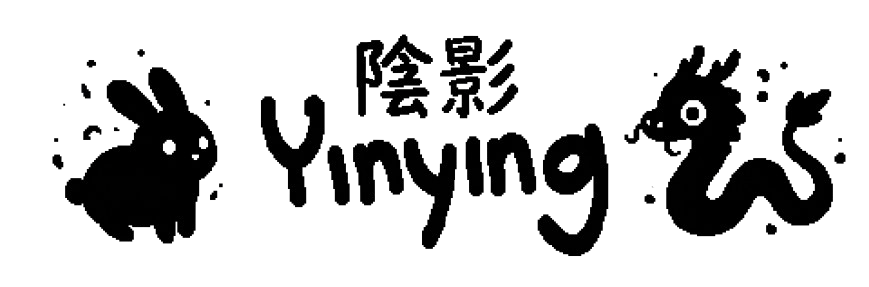

<div align="center">
  <picture>
    <source media="(prefers-color-scheme: dark)" srcset="./assets/banner/banner-light.png">
    <source media="(prefers-color-scheme: light)" srcset="./assets/banner/banner-light.png">
    
  </picture>
</div>

# Yinying · Teatro de Sombras

Yinying es una aplicación web interactiva en la que tu mano actúa simultáneamente como control y personaje. A través de la cámara web, el navegador detecta tus gestos en tiempo real y da vida a marionetas de sombras dentro de un teatro digital de papel recortado.

No hace falta teclado ni ratón para jugar: basta con hacer formas con las manos frente a la cámara. La app traslada el clásico juego de sombras chinescas a una experiencia accesible desde el navegador, sin instalar nada y sin enviar el video a ningún servidor.

---

## Índice

- [Cómo se juega](#cómo-se-juega)
- [Requisitos](#requisitos)
- [Cómo ejecutar el proyecto](#cómo-ejecutar-el-proyecto)
- [Gestos disponibles](#gestos-disponibles)
- [Controles de teclado](#controles-de-teclado)
- [La obra: cinco actos](#la-obra-cinco-actos)
- [Sistema de eventos](#sistema-de-eventos)
- [Características técnicas](#características-técnicas)
- [Estructura del proyecto](#estructura-del-proyecto)
- [Configuración rápida](#configuración-rápida)
- [Modo debug](#modo-debug)
- [Privacidad y rendimiento](#privacidad-y-rendimiento)
- [Solución de problemas](#solución-de-problemas)
- [Documentación adicional](#documentación-adicional)
- [Tecnologías y créditos](#tecnologías-y-créditos)

---

## Cómo se juega

1. Abre la aplicación y **permite el acceso a la cámara** cuando el navegador lo solicite.
2. En la pantalla de inicio, mantén un gesto frente a la cámara durante **1,2 segundos** o pulsa `Espacio` / `Enter`.
3. Mueve la mano para desplazar tu sombra por el escenario.
4. Acerca o aleja la mano de la cámara para **cambiar el tamaño** de la figura (el dragón no escala: su cuello se alarga según la separación entre las dos manos).
5. Al terminar los cinco actos, la obra se **reproduce de nuevo a cámara rápida** (×5) y se muestra el resumen de lo que invocaste.

La mano izquierda mira a la derecha y la derecha mira a la izquierda, de forma que las figuras siempre quedan enfrentadas. Si en tu equipo la orientación sale invertida, pulsa `M`.

---

## Requisitos

- Un navegador moderno con soporte para **getUserMedia** y **WebGL/Canvas** (Chrome, Edge o Firefox recientes).
- Una **cámara web** conectada y con permiso concedido.
- Conexión a internet para cargar `p5.js` y `ml5.js` desde CDN (o servirlos localmente).
- Un servidor HTTP local para servir el proyecto (recomendado; ver abajo). Abrir `index.html` con `file://` puede bloquear la cámara y la carga de sprites según el navegador.

No se necesita Node.js ni proceso de build: el proyecto es HTML, CSS y JavaScript sin dependencias instaladas localmente.

---

## Cómo ejecutar el proyecto

Desde la raíz del repositorio, levanta un servidor estático cualquiera. Algunos ejemplos:

```bash
# Python 3
python -m http.server 8000

# Node.js (si tienes npx)
npx serve .

# PHP
php -S localhost:8000
```

Después abre:

```text
http://localhost:8000
```

> **Importante:** la cámara solo funciona en contextos seguros. `http://localhost` está permitido; si abres el proyecto desde otro equipo de la red mediante una IP, necesitarás HTTPS.

La primera vez que cargues la página, ml5 descargará el modelo de manos. Puede tardar unos segundos según la conexión.

---

## Gestos disponibles

| Animal | Gesto | Detalle |
| ------ | ----- | ------- |
| Conejo 🐇 | Señal de "V" | Índice y medio extendidos; anular y meñique doblados. El pulgar da igual. |
| Pájaro 🐦 | Señal de "L" | Pulgar e índice extendidos; medio, anular y meñique doblados. |
| Dragón 🐲 | Dos manos | Una mano **abierta** hace de cabeza y un **puño** hace de cuerpo. Deben estar cerca: la distancia entre centros, normalizada por el tamaño de la palma, no puede superar `7.0`. |

Consejos:

- Mantén el gesto quieto hasta que se **confirme** (8 fotogramas seguidos). En modo debug verás un anillo amarillo que se llena durante la confirmación.
- El gesto se mantiene mientras la mano siga detectada; se suelta tras 10 fotogramas sin ese gesto.
- Para el dragón, coloca la mano abierta y el puño a la misma altura y relativamente juntos; cuanta más distancia, más segmentos tendrá el cuello.
- Una mano que forma parte de un dragón no se interpreta además como conejo o pájaro.

---

## Controles de teclado

| Tecla | Acción |
| ----- | ------ |
| `D` | Activar / desactivar el **modo debug** (cámara, esqueleto de manos, ratios y panel técnico). |
| `C` | Mostrar / ocultar la **mini cámara** (PIP) en el modo teatro. |
| `M` | Invertir la orientación de las manos (izquierda/derecha). |
| `F` | Activar / desactivar **pantalla completa**. |
| `Espacio` / `Enter` | Empezar la obra o pedir otra al terminar. |

En la pantalla final hay que esperar **5 segundos** antes de poder reiniciar con un gesto; `Espacio` / `Enter` funcionan de inmediato.

---

## La obra: cinco actos

Cada partida genera una obra distinta a partir de una semilla aleatoria. La estructura es fija, pero los eventos concretos cambian.

| Acto | Título | Duración | Plantilla de eventos |
| ---- | ------ | -------- | -------------------- |
| I | El telón se abre | 10 s | `object`, `object` |
| II | Algo cambia | 10 s | `object`, `sky`, `object` |
| III | Surge el peligro | 10 s | `epic`, `object`, `hazard`, `object` |
| IV | Todo se complica | 10 s | `object`, `epic`, `hazard`, `object`, `sky` |
| V | El gran final | 22 s | `epic`, `hazard`, `sky`, `finale` |

- Entre acto y acto se muestra una **tarjeta de intermedio** de 4 segundos. El escenario sigue vivo durante ella: los efectos continúan y la animación no se detiene.
- El **final** empieza al 55 % del acto V (`FINALE_AT = 0.55`) para que le dé tiempo a desplegarse completo: todo arde, hay eclipse, meteoritos, temblor y un apagón final.
- Al acabar, la obra se **repite a ×5** con las sombras y los eventos grabados, y se muestra el **ID de la obra** (la semilla en hexadecimal). La misma semilla produce el mismo plan de eventos.
- En la práctica se colocan entre **16 y 18 eventos** por obra, incluido el final.

---

## Sistema de eventos

El director de la obra vive en `js/acts.js` y planifica todos los eventos **antes de empezar**, usando un generador pseudoaleatorio con semilla (`mulberry32`). El escenario (`js/escenario.js`) solo recibe eventos ya decididos y los dibuja.

Los eventos se agrupan en cinco tipos (cuatro capas de render):

| Tipo | Capa | Ejemplos | Comportamiento |
| ---- | ---- | -------- | -------------- |
| `object` | suelo | árbol, arbusto, caja, roca, casa, farol | Aparecen y se quedan. Máximo 7 a la vez. |
| `hazard` | suelo | incendio, inundación | Transforman el suelo. El incendio quema un objeto; la inundación cubre la parte baja. |
| `sky` | cielo | luna, estrella fugaz, nube, lluvia, viento | Ambiente y clima. Máximo 2 simultáneos. |
| `epic` | pantalla completa | tormenta, eclipse, terremoto, meteoritos | Desastres grandes. Necesitan aire entre ellos. |
| `finale` | pantalla completa | final | Reservado: los efectos incompatibles no pueden pisarlo. |

Reglas principales del planificador:

- **Bolsa barajada:** cada tipo de evento se saca de una bolsa que se rellena y baraja al vaciarse, evitando repetir el mismo nombre seguido y, si es posible, dentro del mismo acto.
- **Sin solapes incompatibles:** fuego contra agua, lluvia/tormenta contra fuego, eclipse contra luna, tormenta contra lluvia/viento.
- **Separación temporal:** al menos 650 ms entre inicios dentro de un acto y 1000 ms de respiro entre efectos de pantalla completa.
- **Separación espacial:** los objetos de suelo buscan el hueco más despejado (24 intentos, separación mínima de 0,14 del ancho útil).
- **Alternativas:** si un tipo no cabe en su hueco, se prueba otro compatible (`epic → sky/hazard`, `hazard → sky/object`, `sky → object`).
- **Reparto del clímax:** el acto V reserva primero el final y coloca el resto de eventos antes, con intensidad creciente.

Los detalles de implementación, las duraciones y una guía para añadir eventos nuevos están en [`docs/EVENTOS.md`](docs/EVENTOS.md).

---

## Características técnicas

- **100 % client-side:** el video se procesa en el navegador; no se envía a ningún servidor.
- **Seguimiento de 21 puntos por mano** con `ml5.handPose` (hasta 4 manos, dos personas).
- **Identidad estable de manos:** cada mano conserva su número entre fotogramas mediante emparejamiento por distancia, evitando cruces e intercambios.
- **Detección geométrica de dedos:** ratios de distancia muñeca-punta / muñeca-PIP, sin modelos adicionales.
- **Confirmación por histéresis:** 8 fotogramas para confirmar un gesto y 10 para soltarlo, lo que evita parpadeos.
- **Suavizado con lerp** y encaje en una rejilla de 2 px de arte: el movimiento es fluido pero mantiene el aspecto pixel art.
- **Tamaño y dirección estables:** la escala se redondea a píxeles enteros y el giro espera 6 fotogramas para evitar parpadeos.
- **Lienzo fijo de 1280×720** (arte base de 320×180 ampliado ×4), con `pixelDensity(1)` y `noSmooth()` para píxeles nítidos.
- **Escenario por capas:** fondo de papel con tramado Bayer, luz de vela, cielo, objetos, sombras, clima/efectos, marco y HUD.
- **Repetición determinista:** se graban los eventos y un fotograma de las sombras cada 100 ms; la repetición reconstruye la obra a ×5.
- **Degradación elegante:** si falta un sprite, se dibuja una sombra vectorial provisional.

---

## Estructura del proyecto

```text
yinying/
├─ index.html              # Carga de librerías y scripts (el orden importa)
├─ css/
│  └─ style.css            # Lienzo 16:9 centrado y escalado sin deformar
├─ js/
│  ├─ config.js            # CFG (calibración) y DURACIONES (eventos)
│  ├─ state.js             # Estado global compartido
│  ├─ hands.js             # Análisis de landmarks y seguimiento de manos
│  ├─ gestures.js          # Detección, estabilidad y actores activos
│  ├─ sprites.js           # Hojas de sprites, animación y dragón articulado
│  ├─ acts.js              # Director: planificación de los 5 actos
│  ├─ escenario.js         # Escenario, efectos, HUD y repetición (Obra)
│  ├─ theater.js           # Render del teatro, sombras y PIP
│  ├─ debug.js             # Overlay de debug
│  └─ main.js              # preload / setup / draw / keyPressed
├─ assets/
│  ├─ marco.png            # Marco del teatro (320×180)
│  ├─ conejo.png           # Hoja de 3 fotogramas en horizontal
│  ├─ pajaro.png
│  ├─ dragon_cabeza.png
│  ├─ dragon_cuerpo.png
│  ├─ dragon_segmento.png
│  ├─ dragon_cola.png
│  └─ banner/
└─ docs/
   ├─ ARQUITECTURA.md
   └─ EVENTOS.md
```

El orden de carga de scripts es intencionado: `config.js` define constantes que usan los demás, `acts.js` debe cargarse antes que `escenario.js`, y este antes que `theater.js` y `main.js`.

---

## Configuración rápida

Casi toda la calibración está en `js/config.js`:

| Constante | Valor por defecto | Para qué sirve |
| --------- | ----------------- | -------------- |
| `BASE_W` / `BASE_H` / `ESCALA` | `320` / `180` / `4` | Resolución de arte y escala del lienzo final (1280×720). |
| `VIDEO_W` / `VIDEO_H` | `640` / `360` | Resolución que se le pasa al modelo. Bajarla mejora los FPS. |
| `MAX_HANDS` | `4` | Manos simultáneas. Reducirlo si el rendimiento baja. |
| `EXT_RATIO` | `1.15` | Umbral para considerar un dedo extendido. |
| `THUMB_RATIO` | `0.75` | Umbral específico del pulgar. |
| `DRAGON_MAX_DIST` | `7.0` | Separación máxima (normalizada) entre cabeza y cuerpo del dragón. |
| `STABLE_FRAMES` / `LOST_FRAMES` | `8` / `10` | Fotogramas para confirmar / soltar un gesto. |
| `MATCH_DIST` / `TRACK_LOST_FRAMES` | `250` / `15` | Seguimiento de manos entre fotogramas. |
| `TAM_REF` | `110` | Tamaño de mano que produce la escala normal del sprite. |
| `ESC_MIN` / `ESC_MAX` | `2` / `7` | Límites de escala de conejo y pájaro. |
| `DIR_FRAMES` | `6` | Fotogramas para confirmar un cambio de dirección. |
| `INVERTIR_MANOS` | `false` | Invierte izquierda/derecha (también con `M`). |

Los tiempos de los eventos se comparten entre el director y el escenario en la tabla `DURACIONES` (también en `js/config.js`): `acts.js` la usa para planificar sin solapes y `escenario.js` para dibujar. Si cambias una duración, hazlo ahí; revisa también `escenario.js` si el efecto tiene casos especiales (el final usa 9500 ms para sus sub-efectos y 9000 ms para la combustión de los objetos).

La planificación de la obra se ajusta en el `CFG` interno de `js/acts.js`:

| Constante | Valor | Efecto |
| --------- | ----- | ------ |
| `actMs` | `[10000, 10000, 10000, 10000, 22000]` | Duración de cada acto. |
| `interludeMs` | `4000` | Duración de las tarjetas de intermedio. |
| `replaySpeed` | `5` | Velocidad de la repetición. |
| `minGap` | `0.14` | Separación mínima entre objetos de suelo (0..1). |
| `maxProps` | `7` | Objetos de suelo vivos a la vez. |
| `minEventGap` | `650` | Milisegundos mínimos entre dos eventos. |
| `fullGap` | `1000` | Respiro entre efectos de pantalla completa. |
| `maxSky` | `2` | Efectos de cielo simultáneos. |
| `FINALE_AT` | `0.55` | Punto del acto V donde arranca el final. |

---

## Modo debug

Pulsa `D` para alternar entre el teatro y la vista de depuración. El modo debug muestra:

- El video de la cámara con el **esqueleto de las 21 articulaciones** de cada mano.
- Las puntas de los dedos en **verde** (extendido) o **rojo** (doblado).
- El **número e identidad** de cada mano, con un color distinto.
- Un **panel** con FPS, número de manos, resolución nativa de la cámara, ratios por dedo, patrón `10110`, tamaño de mano y escala resultante.
- El **anillo de progreso** amarillo mientras un gesto se confirma.
- La **separación del dragón** y si está dentro del máximo permitido.
- Una barra inferior con los gestos confirmados en ese instante.

Es la forma más rápida de calibrar `EXT_RATIO`, `THUMB_RATIO` y `DRAGON_MAX_DIST` con tu cámara e iluminación.

---

## Privacidad y rendimiento

- **Privacidad:** todo el procesamiento ocurre en el navegador. El video de la cámara no se sube ni se almacena; la repetición se reconstruye en memoria a partir de datos de posición.
- **Rendimiento:** si los FPS bajan, reduce `MAX_HANDS` o `VIDEO_W`/`VIDEO_H`. El modelo de manos es la parte más costosa; el render es ligero porque el arte base es de 320×180.
- **Iluminación:** una escena bien iluminada y una mano completa dentro del encuadre mejoran mucho la detección. Evita contraluz fuerte y fondos con mucho movimiento.
- **Distancia:** si la mano está muy lejos, los dedos se confunden; si está muy cerca, puede salirse del encuadre. La zona cómoda es con la mano ocupando entre un cuarto y la mitad del alto del video.

---

## Solución de problemas

**No aparece la cámara o el navegador bloquea el acceso**
- Comprueba que has concedido el permiso en el icono de la barra de direcciones.
- Abre la app desde `http://localhost` o HTTPS, no desde `file://`.
- Cierra otras aplicaciones que estén usando la cámara.

**La pantalla se queda en "iniciando" o no detecta manos**
- Espera a que termine de descargarse el modelo de ml5.
- Revisa la consola del navegador por si el CDN está bloqueado; en ese caso, descarga `p5.min.js` y `ml5.min.js` y sírvelos localmente.
- Ilumina la mano y mantenla entera dentro del encuadre.

**El gesto se activa o desactiva solo**
- Aumenta `STABLE_FRAMES` para exigir más confirmación.
- Ajusta `EXT_RATIO` / `THUMB_RATIO` con ayuda del modo debug (`D`).
- Evita fondos con manos u objetos similares en movimiento.

**El conejo o el pájaro salen girados**
- Pulsa `M` o cambia `INVERTIR_MANOS` en `js/config.js`.

**El dragón no aparece**
- Acerca la mano abierta y el puño: la separación normalizada debe ser ≤ `DRAGON_MAX_DIST`.
- Asegúrate de que una mano está completamente abierta y la otra cerrada en puño.
- En modo debug verás el valor de separación y si está dentro del máximo.

**La imagen se ve borrosa o deformada**
- El lienzo mantiene 16:9 y usa `image-rendering: pixelated`; es normal que el pixel art se vea ampliado.
- Si la cámara no ofrece 16:9, el video se estira para encajar. El modo debug muestra la resolución nativa y avisa si no es 16:9.

---

## Documentación adicional

- [`docs/ARQUITECTURA.md`](docs/ARQUITECTURA.md) — flujo de datos, módulos, coordenadas, capas de render y repetición.
- [`docs/EVENTOS.md`](docs/EVENTOS.md) — planificador de actos, reglas de conflicto, duraciones y cómo añadir eventos.

---

## Tecnologías y créditos

- **[p5.js](https://p5js.org/)** — renderizado en canvas, bucle de animación y gestión de imagen/video.
- **[ml5.js](https://ml5js.org/) (`handPose`)** — detección de manos del lado del cliente.
- Versiones fijadas en `index.html`: **p5.js 1.11.3** y **ml5.js 1**.
- **HTML5, CSS3 y JavaScript (ES6)**.
- Sprites y marco del teatro creados en **Aseprite**.
- Tipografía de la interfaz: monoespaciada del sistema.

Proyecto académico de la Universidad. No se incluye una licencia explícita en el repositorio; consulta con sus autores antes de reutilizar los assets.
